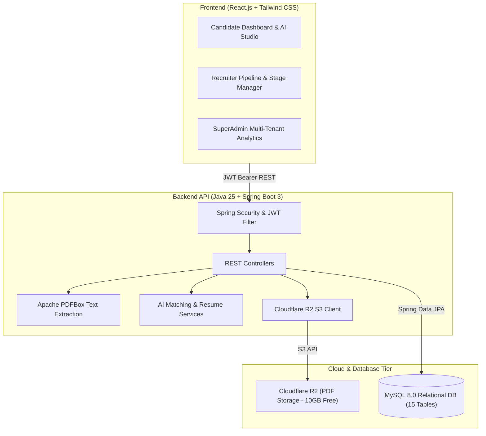

# HireSmart AI 🎯
### Intelligent Recruitment & Talent Management Platform
**VCUBE HACK QUEST 1.0 — Problem 1: HR Tech / AI-Powered Smart Recruitment**

[](https://www.oracle.com/java/)
[](https://spring.io/projects/spring-boot)
[](https://react.dev/)
[](https://tailwindcss.com/)
[](https://www.cloudflare.com/developer-platform/r2/)
[](https://www.mysql.com/)

---

## 📌 Executive Summary

**HireSmart AI** is a production-style, database-driven, multi-tenant AI talent acquisition platform connecting **Candidates**, **Recruiters**, and **SuperAdmins**.

The platform automates the modern recruitment lifecycle using explainable Generative AI:
- **Zero Database Bloat**: Resumes are uploaded to **Cloudflare R2** object storage (10 GB free tier with zero egress fees). MySQL stores only the metadata, storage keys, and plain text extracted via **Apache PDFBox**.
- **Explainable AI Job Matching Engine**: Computes candidate-job alignment using a strict weighted formula:
  $$\text{Match Score} = (40\% \times \text{Skills}) + (25\% \times \text{Experience}) + (20\% \times \text{Projects}) + (15\% \times \text{Education})$$
- **AI Resume Analyzer & ATS Improvement Assistant**: Extracts competencies, pinpoints gaps, and offers side-by-side STAR methodology rewrites.
- **AI Mock Video Interview Studio**: Browser webcam/microphone recording with speech-to-text transcripts and comprehensive AI scoring reports.

---

## 🧱 System Architecture



---

## 🗄️ Database Design (15 Relational Tables)

HireSmart AI is backed by 15 normalized tables with foreign keys and multi-tenant isolation:

1. `users`: Base identity with BCrypt password hashing & roles (`ADMIN`, `RECRUITER`, `CANDIDATE`).
2. `companies`: Multi-tenant organization records.
3. `candidates`: Education, skills, work history, portfolio URLs.
4. `recruiters`: Recruiter profile linked to company tenant.
5. `jobs`: Job requirements, experience levels, salary range, and required skills JSON.
6. `resumes`: Cloudflare R2 storage key, CDN URL, and extracted PDFBox text.
7. `resume_analysis`: AI-parsed competencies, strengths, missing credentials, suggested improvements.
8. `applications`: Candidate job applications with AI match score and stage status.
9. `email_verifications`: 6-digit OTP codes for verification & password reset.
10. `interviews`: Scheduled technical & HR interview sessions.
11. `interview_questions`: AI-generated role-specific questions.
12. `interview_answers`: Candidate recorded responses & transcripts.
13. `interview_reports`: AI evaluation scores (Technical, Clarity, Relevance, Overall).
14. `application_status_history`: Audit trail of applicant stage changes.
15. `audit_logs`: Enterprise security activity logging.

*Complete DDL schema: [`database/schema.sql`](file:///c:/Users/shrav/OneDrive/Desktop/ai%20recruitment/database/schema.sql)*  
*Seed data: [`database/seed.sql`](file:///c:/Users/shrav/OneDrive/Desktop/ai%20recruitment/database/seed.sql)*  
*Entity Relationship Diagram: [`database/ER_DIAGRAM.md`](file:///c:/Users/shrav/OneDrive/Desktop/ai%20recruitment/database/ER_DIAGRAM.md)*

---

## 🚀 Quick Start Guide

### 1. Prerequisites
- **Node.js** v18+ & **npm**
- **Java 25 JDK** & **Maven**

---

### 2. Run the React Frontend

Open your terminal:
```bash
cd "c:\Users\shrav\OneDrive\Desktop\ai recruitment\frontend"
npm install
npm run dev
```

Open **[http://localhost:5173](http://localhost:5173)** in your browser!

> [!TIP]
> **Hackathon 1-Click Role Switcher**: Click the **Role:** pills in the top navbar to instantly test:
> - **Candidate** (`Alex Johnson`)
> - **Recruiter** (`Sarah Jenkins` at TechCorp Innovations)
> - **Admin** (`SuperAdmin`)

---

### 3. Run the Spring Boot Backend (Java 25)

In a separate terminal:
```bash
cd "c:\Users\shrav\OneDrive\Desktop\ai recruitment\backend"

# Run with embedded in-memory database & preloaded seed data
./mvnw spring-boot:run -Dspring-boot.run.profiles=dev
```

Or open the `backend/` folder in **IntelliJ IDEA** or **Eclipse** with Java 25 JDK and run `HireSmartApplication.java`.

---

## ☁️ Cloudflare R2 Configuration (10 GB Free Tier)

To link your own Cloudflare R2 bucket:
1. Log in to [Cloudflare Dashboard](https://dash.cloudflare.com) -> **R2** -> **Create Bucket** (e.g. `hiresmart-resumes`).
2. Go to **Manage R2 API Tokens** -> **Create API Token** (Object Read & Write permission).
3. Set the variables in `.env` or your terminal:
   ```env
   R2_ENDPOINT=https://<your-account-id>.r2.cloudflarestorage.com
   R2_ACCESS_KEY=<your-access-key-id>
   R2_SECRET_KEY=<your-secret-access-key>
   R2_BUCKET_NAME=hiresmart-resumes
   R2_PUBLIC_URL=https://pub-<your-r2-id>.r2.dev
   ```

*(If Cloudflare R2 keys are omitted, HireSmart AI automatically utilizes a local disk fallback without failing).*

---

## 🧪 Postman API Testing Suite

A complete Postman collection is included in [`postman/HireSmart_AI.postman_collection.json`](file:///c:/Users/shrav/OneDrive/Desktop/ai%20recruitment/postman/HireSmart_AI.postman_collection.json):
- `POST /api/auth/register` & `POST /api/auth/login`
- `GET /api/jobs` (search & skills filter)
- `POST /api/resumes/upload` (Multipart PDF -> Cloudflare R2 -> Apache PDFBox)
- `POST /api/applications` (1-Click apply & automatic AI score calculation)
- `POST /api/ai/analyze-resume` & `POST /api/ai/match-job`
- `GET /api/recruiter/dashboard` & `GET /api/admin/dashboard`
